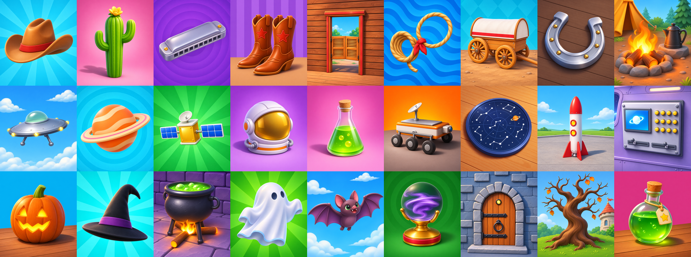
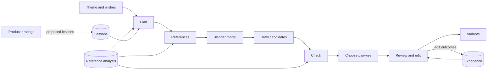

# Playrix AI producer test task

A tool that turns a theme and a producer's free-form wishes into 3–5 versions of a ten-card collection set, drawn to sit beside the game's own cards, and the analysis of the reference collection behind it. Brief: [task](materials/01_task_description.md), [collections](materials/02_collection_explanation.md), [art guide](materials/03_art_guide.md), [Miro board](https://miro.com/app/board/uXjVEUZR5u0=/).



*Batch 2, one version per film genre, object cards only: graded 3.85 of 5 by the producer, beside their references and not blind. The final sets are being redrawn with the current pipeline; the earlier ones are in `runs/final/`.*

| The brief asks for | Here |
|---|---|
| An analysis of how the reference sets are built and drawn | [analysis/SYNTHESIS.md](analysis/SYNTHESIS.md), dashboard `analysis/report.html` |
| A tool: theme and wishes in, 3–5 variants of a set out | The [make-card-set skill](.claude/skills/make-card-set/SKILL.md) over `scripts/make_set.py` |
| Three film-genre sets, no gold cards | `runs/final/` |
| Our sets against the references | [analysis/COMPARISON.md](analysis/COMPARISON.md) |
| The process and what was tried | [PROCESS.md](PROCESS.md), [STYLE_GAPS](analysis/STYLE_GAPS.md), [experiments/](experiments/README.md), [runs/](runs/README.md) |

## Results

- **Style:** blind, the producer finds our drawing in 24 of 32 final-style twins, down from 31 of 32. Calibrated model reviewers are at chance on 16 of the same twins, so the human stays the measure.
- **Construction:** in a six-object trial, Blender blockouts cut broken cards from 5 of 12 to 1, and to none once the models were fixed after seeing the real cards (grade 3.7 against 2.2). So the planner models built objects; simple forms are drawn from words.
- **Sets:** the producer's grades (not blind) rose from 3.63 to 3.97 between two batches: half from the three character cards, the rest mostly from better object choice. Most low grades trace to the plan, and each became a lesson the planner reads.
- **Robustness:** 19 odd or hostile requests all produced plans, with forbidden wishes declined and named in the report: non-English and emoji themes, real brands, franchises, weapons, gore, prompt injection. After two repairs, War and Gangsters kept three cards still flagged for the producer, and Elections stayed a voting set. Kitchen, Pirates and a Star Wars request ran end to end ([experiments/robustness.py](experiments/robustness.py)).
- **Generators:** Codex stays on evidence: on the same twins and prompts the art director preferred it to Nano Banana Pro 11 to 0 and to Qwen-Image-2.1 (open weights, local) 39 to 1; CSD agrees. See [STYLE_GAPS](analysis/STYLE_GAPS.md#generator-bake-off-2026-11-07).

## Make a set

```sh
.venv/bin/python -B scripts/make_set.py "Western" --wishes "A set for a Movie collection" --variants 3
```



| Stage | What happens |
|---|---|
| Plan | Claude Sonnet plans the variants by rules taken from the real sets and the producer's [lessons](analysis/lessons.md). A second call flags cards that could upset players, and the plan is repaired, at most twice. Wishes the rules forbid, and anything still flagged, are listed in the report. `spec.md` documents the set as designed, before any drawing |
| References | Each card gets three real cards: same art category, backdrop pattern and object class, ties broken by text search over the card images (`search.py`) |
| Model | For built objects of several parts, Claude Opus writes a Blender model, looks at its render and fixes it, up to two rounds. Simple forms skip this |
| Draw | Codex's image model draws three candidates per card, restyling the model's render where there is one |
| Check | Each candidate is measured like the references: per-category ranges, CSD distance to the real cards, and a blind look at what it shows and how it is staged |
| Choose | The art director compares candidates two at a time, in both orders. Close wins are marked for a human look |
| Review | Nine specialists review each variant blind beside hidden real controls; the director turns their reports into edit notes |
| Edit | Codex applies the notes. An edit stays only if it beats its draft, and every outcome is saved for later runs |
| Deliver | `runs/<theme>/variant_N/`, a sheet per variant and `report.md` |

A run first checks that its tools and data are in place. A rerun of the same request continues where it stopped; another request for the same theme gets `runs/<theme>-2`. `--alongside <folder> ...` names the other sets of the same collection, whose objects the plan must not repeat. `--plan <file>` draws a plan a producer has checked, such as the drafts in `runs/plans/`. `--candidates 1 --review-rounds 0` gives a quick draft. `--cast 1` adds a character card per variant, drawn with the game's cast. `scripts/screen.py <folder> --variant 1 --color blue` places a variant in the game's window.

One run peaks at about 5 GB of GPU memory and each Blender render adds about 2 GB, so on a 24 GB card three runs fit at once with `--workers 2`.

## Teach it

- **Lessons.** [analysis/lessons.md](analysis/lessons.md) holds rules learned from the producer's grades, in plain words the planner reads. Edit it to teach the tool. `scripts/experience.py propose` drafts new lessons from rating comments and lost edits, for a person to accept.
- **Experience.** Every edit and whether it beat its draft goes to `analysis/experience.json`, and the director sees past notes that won and lost.
- **Ratings.** `scripts/rate_ui.py` serves a rating page at http://127.0.0.1:8765: blind twins, set cards beside their references, trials. Answers go to `runs/ratings.json`.

## Tried and dropped

- Correction rounds (they rescued 8 of 24 cards), replaced by candidates and edits; a second review round, which kept 0 of 11 edits.
- Construction and perspective checkers: at chance on 93 pairs the producer labelled.
- Automatic tuning of the director's notes: gains on the tuning half did not hold out.
- Tone rounds that moved measured darks onto the real cards: the producer preferred neither.
- Pre-drawn characters, pasted (1.5–1.8) or attached (2.4), against 3.8 for drawing them in one go with real cutouts.
- Measured geometry for reviewers, search-picked references, five references, a backdrop grade: no gain.

Each has its numbers in [STYLE_GAPS](analysis/STYLE_GAPS.md) and its script in [experiments/](experiments/README.md).

## Glossary

- **Producer:** the author, playing the brief's producer. Every human grade in `runs/ratings.json` is theirs, blind unless noted.
- **Twin:** a real card redrawn from a text brief with that card hidden from the generator. Content is held equal, so what differs is style.
- **Style rounds:** versions of the style text. On 12 twins, `baseline` and `r1`–`r8` (`runs/twins`). On 40, `old` (the first run's style), `final` (the text settled after r8), `r3`, `r9` (final plus a line on how parts attach) and `p1`–`p3` (`runs/twins40`). The current text is in `scripts/style.py`.
- **Blockout:** a Blender model of the object, rendered and restyled by the image model.
- **Category 1–5:** the art guide's staging: floating, plain floor, real surface, in its place, characters.
- **CSD:** a style embedding. Its similarity to the same object's real card is the one embedding measure that tracked the producer.
- **Specialists and director:** nine model reviewers, one per art vector, and an art director, in [analysis/agents/](analysis/agents/README.md).

## The cast

The reference collection has one cast: a man with glasses and a mustache, a pig, a sheep, a cow and a rooster. `scripts/cast.py find` cuts them out of the reference cards with SAM 3, `label` records view, pose and outfit. These cutouts are the approved library: a character card attaches the clearest ones and the cast stays itself. Cutouts and cards showing the cast are Playrix art and stay out of git.

## Setup

Needs a ROCm or CUDA GPU with PyTorch, the Codex and Claude CLIs logged in, Blender on the PATH, and the board images in `materials/` at the paths in `sources/image_manifest.json`. Board images, model weights and derived data are not in git.

```sh
python -m venv .venv
.venv/bin/pip install -r requirements.txt
.venv/bin/python -B scripts/embed.py
.venv/bin/python -B scripts/estimate.py masks marigold
.venv/bin/python -B -m unittest discover -s tests    # the board images are complete and unchanged
```

DINOv3 and SAM 3 are gated on Hugging Face: put `HUGGING_FACE_API_KEY` in `.env`, then run `scripts/embed.py --models dinov3` and `HF_HUB_OFFLINE=0 .venv/bin/python -B scripts/cast.py find`, then `cast.py label`. The key goes only to these downloads.

**External code.** BiRefNet, Depth Anything 3 and DeepGaze run upstream code, so each is pinned to a reviewed revision (BiRefNet and DA3 weights in `scripts/estimate.py`; sources: `depth-anything-3` at `3d835ec`, `DeepGaze` at `c7db17e`, cloned into `.models/src/`). The review scanned all 295 fetched Python files, read the code that runs and loaded every checkpoint with PyTorch's restricted loader; test runs under an audit hook showed no network or writes outside the project. It was not line by line. SAM 3, SigLIP 2, DINOv2, DINOv3, CSD and Qwen-Image load through `transformers`, `open_clip` and `diffusers` with no remote code.

## Change the generator or the style

`scripts/draw.py` holds the generator, so another model replaces one function; `experiments/generators.py` shows two. Style wording is high-gain: change one thing, redraw the twins and compare them with their real cards.

```sh
.venv/bin/python -B scripts/validate.py twins --label r9
.venv/bin/python -B scripts/review.py twins r9 --rater claude-opus-5-5 --lessons baseline r3 r8
```

## Layout

| Path | Contents |
|---|---|
| `scripts/` | The pipeline and the reference analysis |
| `experiments/` | One-off studies behind the pipeline's decisions |
| `analysis/` | Findings and analysis outputs. `knowledge.json`, `cards.json`, `lessons.md` and `cast.json` are what the pipeline reads. `VOCABULARY.md` and `TOOLS.md` are the specialists' language and evidence |
| `analysis/agents/` | The specialists, the art director and the modeller |
| `runs/` | Every generated card and measurement, indexed in `runs/README.md` |
| `research/` | Literature and market research, and a landscape check of current models and tools ([index](research/README.md)) |
| `materials/`, `sources/` | Task documents, board export and image manifests |
| `library/` | Cast cutouts. Not in git |

## Reference analysis

Run from the project root; each step skips finished work. The form every rater fills is in `scripts/form.py`.

```sh
.venv/bin/python -B scripts/map_sets.py
.venv/bin/python -B scripts/rate.py cards --rater codex    # also: claude, qwen3.8:27b-q4_K_M, gemma4:31b
.venv/bin/python -B scripts/rate.py sets --rater codex
.venv/bin/python -B scripts/estimate.py masks depth attention marigold
.venv/bin/python -B scripts/embed.py
.venv/bin/python -B scripts/measure.py
.venv/bin/python -B scripts/summarize.py
.venv/bin/python -B scripts/cluster.py
.venv/bin/python -B scripts/knowledge.py
.venv/bin/python -B scripts/build_report.py    # analysis/report.html, opened from disk
```

To refresh the materials from the board, update `sources/board.svg` and `sources/original_images.json`, then run `scripts/export_materials.py`.
