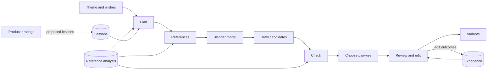

# Playrix AI producer test task

A tool that turns a theme and a producer's free-form wishes into 3–5 variants of a ten-card collection set, drawn to sit beside the game's own cards, and the analysis of the reference collection behind it. Brief: [task](materials/01_task_description.md), [collections](materials/02_collection_explanation.md), [art guide](materials/03_art_guide.md), [Miro board](https://miro.com/app/board/uXjVEUZR5u0=/).


*The three film sets, object cards only. The producer graded each set 5 of 5; card means 4.5 Western, 3.8 Period Drama, 4.0 Detective. [The final sets](runs/final6/README.md).*

| The brief asks for | Here |
|---|---|
| An analysis of how the reference sets are built and drawn | [analysis/SYNTHESIS.md](analysis/SYNTHESIS.md), dashboard `analysis/report.html` |
| A tool: theme and wishes in, 3–5 variants of a set out | The [make-card-set skill](.claude/skills/make-card-set/SKILL.md) over `scripts/make_set.py` |
| Three film-genre sets, no gold cards | `runs/final5/western-2`, `runs/final5/period-drama`, `runs/final6/detective`, each with its `spec.md`; six bonus cast cards in `runs/final4/cast` |
| Our sets against the references | [analysis/COMPARISON.md](analysis/COMPARISON.md) |
| What was tried and why | [PROCESS.md](PROCESS.md), with the evidence in [STYLE_GAPS](analysis/STYLE_GAPS.md), [experiments/](experiments/README.md) and [runs/](runs/README.md) |

## Results

- **Final sets:** drawn once, then three fix rounds redrew only the cards the producer commented on (17, 8, then 1). Set grades went from 4, 4, 4 to 5, 5, 5; the six cast cards ended at 5.0.
- **Style:** blind, the producer still finds our drawing in 24 of 32 final-style twins, down from 31 of 32 for the first style. Calibrated model reviewers are at chance on 16 of the same twins, so the producer stays the measure.
- **Construction:** in a six-object trial, Blender blockouts cut broken cards from 5 of 12 to 1, and to none once the models were fixed (grade 3.7 against 2.2). The planner models built objects; simple forms are drawn from words.
- **Plans matter most:** between two graded batches the mean rose from 3.63 to 3.97, half from three character cards and most of the rest from better object choices. Low grades traced to the plan and became [lessons](analysis/lessons.md) the planner reads.
- **Robustness:** 19 odd or hostile requests (emoji and non-English themes, brands, franchises, weapons, gore, prompt injection) all produced plans, with forbidden wishes declined and named in the report.
- **Generator:** on the same twins and prompts the art director preferred Codex to Nano Banana Pro 11 to 0 and to Qwen-Image-2.1 39 to 1; CSD agrees.

## Make a set

```sh
.venv/bin/python -B scripts/make_set.py "Western" --wishes "A set for a Movie collection" --variants 3
```



| Stage | What happens |
|---|---|
| Plan | Claude Sonnet plans the variants by rules taken from the real sets and the producer's [lessons](analysis/lessons.md). A second call flags cards that could upset players, and the plan is repaired at most twice. Declined wishes and cards still flagged head the report. `spec.md` describes the set card by card before drawing |
| References | Each card gets three real cards of the same art category, backdrop pattern and object class; text search over the card images breaks ties |
| Model | For built objects of several parts, Claude Opus writes a Blender model, looks at its render and fixes it, up to two rounds |
| Draw | Codex's image model draws three candidates per card, restyling the model's render where there is one |
| Check | Each candidate is measured like the references: per-category ranges, CSD distance to the real cards, and a blind look at what it shows |
| Choose | The art director compares candidates two at a time, in both orders. Close wins are marked for a human look |
| Review | Nine specialists review each variant beside hidden real cards; the director turns their reports into edit notes |
| Edit | Codex applies the notes. An edit stays only if it beats its draft, and the outcome is saved for later runs |
| Deliver | `runs/<theme>/variant_N/`, a sheet per variant and `report.md` |

A run first checks that its tools and data are in place. Rerunning the same request continues where it stopped; another request for the same theme gets `runs/<theme>-2`. Options:

- `--alongside <folder> ...`: other sets of the same collection, whose objects the plan must not repeat.
- `--plan <file>`: draw a plan a producer has checked, such as those in `runs/plans/`.
- `--cast N`: add N character cards per variant, drawn with the game's cast.
- `--keep <folder>` with `--plan` and `--run`: a fix round. Cards whose plan is unchanged keep their drawings and picks; only the others are drawn again. A card's `note`, such as the producer's fix, closes its brief, and the review may not undo it.
- `--candidates 1 --review-rounds 0`: a quick draft.
- `scripts/screen.py <folder> --variant 1 --color blue` places a variant in the game's window.

One run peaks at about 5 GB of GPU memory and each Blender render adds about 2 GB; on a 24 GB card three runs fit at once with `--workers 2`. A variant takes about 40 minutes.

## Teach it

- **Lessons:** [analysis/lessons.md](analysis/lessons.md) holds rules learned from the producer, in plain words the planner reads. Edit it to teach the tool. `scripts/experience.py propose` drafts new lessons from rating comments and lost edits, for a person to accept.
- **Experience:** every edit and whether it beat its draft goes to `analysis/experience.json`; the director sees past notes that won and lost.
- **Ratings:** `scripts/rate_ui.py` serves a rating page at http://127.0.0.1:8765 (blind twins, set cards beside their references, trials). Answers go to `runs/ratings.json`.

## Glossary

- **Producer:** the author, playing the brief's producer. Every human grade in `runs/ratings.json` is theirs unless noted.
- **Twin:** a real card redrawn from a text brief with that card hidden from the generator. Content is equal, so what differs is style.
- **Style rounds:** versions of the style text: `baseline` and `r1`–`r8` on 12 twins (`runs/twins`); `old`, `final`, `r3`, `r9` and `p1`–`p3` on 40 (`runs/twins40`). The current text is in `scripts/style.py`.
- **Blockout:** a Blender model of the object, rendered and restyled by the image model.
- **Category 1–5:** the art guide's staging: floating, plain floor, real surface, in its place, characters.
- **CSD:** a style embedding. Its similarity to the same object's real card is the one embedding measure that tracked the producer.
- **Specialists and director:** nine model reviewers, one per art vector, and an art director, in [analysis/agents/](analysis/agents/README.md).

## The cast

The reference collection has one cast: a man with glasses and a mustache, a pig, a sheep, a cow and a rooster. `scripts/cast.py find` cuts them out of the reference cards with SAM 3, and `label` records view, pose and outfit. A character card attaches the clearest cutouts, so the cast stays itself. Cutouts and cards showing the cast are Playrix art and stay out of git.

## Setup

Needs a ROCm or CUDA GPU with PyTorch, the Codex and Claude CLIs logged in, Blender on the PATH, and the board images in `materials/` at the paths in `sources/image_manifest.json`. Board images, model weights and derived data are not in git.

```sh
python -m venv .venv
.venv/bin/pip install -r requirements.txt
.venv/bin/python -B scripts/embed.py
.venv/bin/python -B scripts/estimate.py masks marigold
.venv/bin/python -B -m unittest discover -s tests    # the board images are complete and unchanged
```

DINOv3 and SAM 3 are gated on Hugging Face: put `HUGGING_FACE_API_KEY` in `.env`, then run `scripts/embed.py --models dinov3` and `HF_HUB_OFFLINE=0 .venv/bin/python -B scripts/cast.py find`, then `cast.py label`. The key is used only for these downloads.

**External code.** BiRefNet, Depth Anything 3 and DeepGaze run upstream code, so each is pinned to a reviewed revision: BiRefNet and DA3 weights in `scripts/estimate.py`, sources `depth-anything-3` at `3d835ec` and `DeepGaze` at `c7db17e`, cloned into `.models/src/`. The review scanned all 295 fetched Python files, read the code paths that run and loaded every checkpoint with PyTorch's restricted loader; test runs under an audit hook made no network calls or writes outside the project. SAM 3, SigLIP 2, DINOv2, DINOv3, CSD and Qwen-Image load through `transformers`, `open_clip` and `diffusers` with no remote code.

## Change the generator or the style

`scripts/draw.py` holds the generator, so another model replaces one function; `experiments/generators.py` shows two. Style wording is high-gain: change one thing, redraw the twins and compare them with their real cards.

```sh
.venv/bin/python -B scripts/validate.py twins --label r9
.venv/bin/python -B scripts/review.py twins r9 --rater claude-opus-5-5 --lessons baseline r3 r8
```

## Layout

| Path | Contents |
|---|---|
| `scripts/` | The pipeline and the reference analysis |
| `experiments/` | One-off studies behind the pipeline's decisions |
| `analysis/` | Findings and analysis outputs. The pipeline reads `knowledge.json`, `cards.json`, `lessons.md` and `cast.json`; `VOCABULARY.md` and `TOOLS.md` are the specialists' language and evidence |
| `analysis/agents/` | The specialists, the art director and the modeller |
| `runs/` | Every generated card and measurement, indexed in `runs/README.md` |
| `research/` | Literature, market research and a check of current models and tools ([index](research/README.md)) |
| `materials/`, `sources/` | Task documents, board export and image manifests |
| `library/` | Cast cutouts. Not in git |

## Reference analysis

Run from the project root; each step skips finished work. The form every rater fills is in `scripts/form.py`.

```sh
.venv/bin/python -B scripts/map_sets.py
.venv/bin/python -B scripts/rate.py cards --rater codex    # also: claude, qwen3.8:27b-q4_K_M, gemma4:31b
.venv/bin/python -B scripts/rate.py sets --rater codex
.venv/bin/python -B scripts/estimate.py masks depth attention marigold
.venv/bin/python -B scripts/embed.py
.venv/bin/python -B scripts/measure.py
.venv/bin/python -B scripts/summarize.py
.venv/bin/python -B scripts/cluster.py
.venv/bin/python -B scripts/knowledge.py
.venv/bin/python -B scripts/build_report.py    # analysis/report.html, opened from disk
```

To refresh the materials from the board, update `sources/board.svg` and `sources/original_images.json`, then run `scripts/export_materials.py`.
