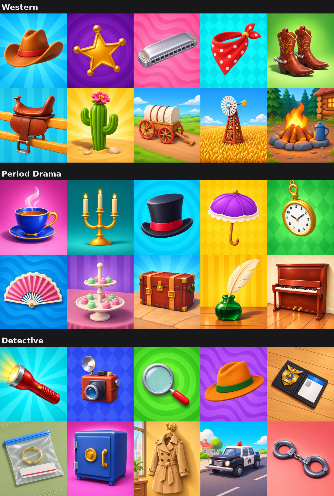

# The final sets

| Set | Folder | Plan |
|---|---|---|
| Western | `runs/final5/western-2/` | `runs/plans/final-western-3.json` |
| Period Drama | `runs/final5/period-drama/` | `runs/plans/final-period-drama-5.json` |
| Detective | `runs/final6/detective/` | `runs/plans/final-detective-6.json` |
| Cast bonus, two cards per genre | `runs/final4/cast/` | `runs/plans/final-cast-2.json` |

Producer's grades, latest per card: sets 5, 5, 5, cast 5; cards 4.5 Western, 3.8 Period Drama, 4.0 Detective (nine cards; the new Magnifier was not graded), 5.0 cast. Two minor comments were left as they are: the Pocket Watch "may have some problems with the perspective", and the hat on the man in Sheriff Pals is "a tad misplaced".

`final_sets.png` shows the object cards; the cast cards show the game's characters and stay out of git. History: [first draw](../final3/README.md), [fix round 1](../final4/README.md), [fix round 2](../final5/README.md), fix round 3 below.

## Fix round 3

The producer graded fix round 2 (`runs/final5`): every set 5 of 5, "close to being satisfied". The one comment was the Magnifier, 1: "Too large the glass is, and the handle is too small". The Top Hat got 3 again without a comment, and the Candelabra (3) "looks fine... probably decent as it is". This round's two redraws were not graded by the producer: a redraw replaced the fix-round-2 card only if it was clearly better against the comment.

| Card | Change | Kept? |
|---|---|---|
| Magnifier | Fix round 1's long thin handle was "elongated", fix round 2's short one "too small". The handle is now 0.40 long and sturdy, about 0.85 of the lens's width from the rim, as on the real Map card, and the blockout is framed at 0.9 so the glass is smaller | Yes, `detective/` v1_03_9: smaller glass, sturdy handle |
| Top Hat | Every one of the sixteen candidates drawn from text curled one side of the brim higher. Built in Blender with an even brim, seen almost from the front | No: the brim is even, but the hat is a stiff frontal stovepipe, less appealing than before, and the pick turned it navy. `top-hat-trial/` is kept for the record |

## Set numbers

| Set | Object classes | Scale classes | Backdrop hues | Style similarity |
|---|---:|---:|---:|---:|
| Real sets, range | 4-7 | 2-5 | 6-7 | 0.603-0.641 |
| Western | 7 | 5 | 6 | 0.560 |
| Period Drama | 7 | 2 | 6 | 0.551 |
| Detective | 6 | 4 | 9 | 0.474 |

`compare.json` from `scripts/compare.py --sets runs/final6/sets.json`; the full comparison is in [COMPARISON](../../analysis/COMPARISON.md). The review page, `experiments/final_review.py serve`, shows this assembly as its round 4.
